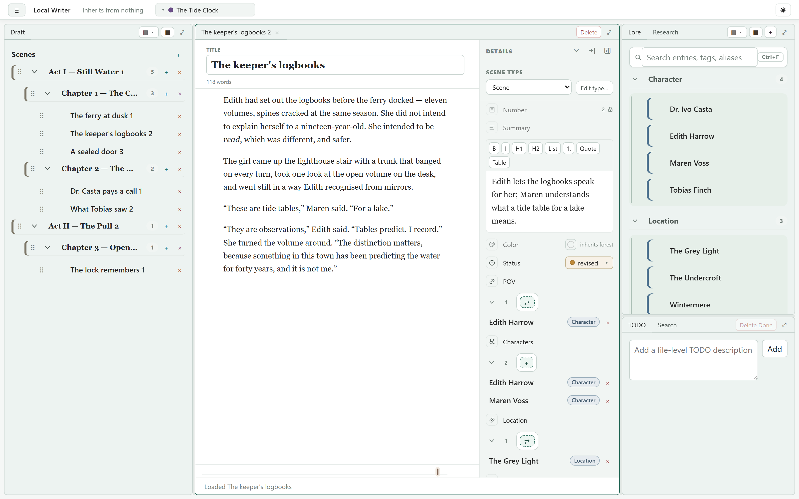
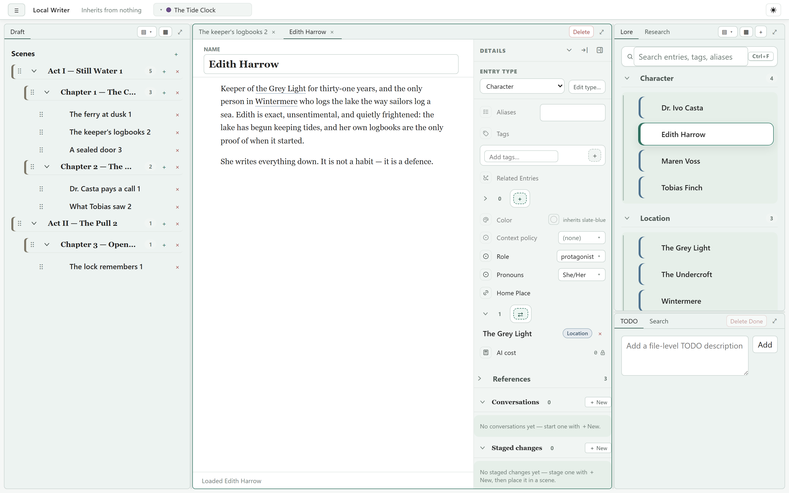
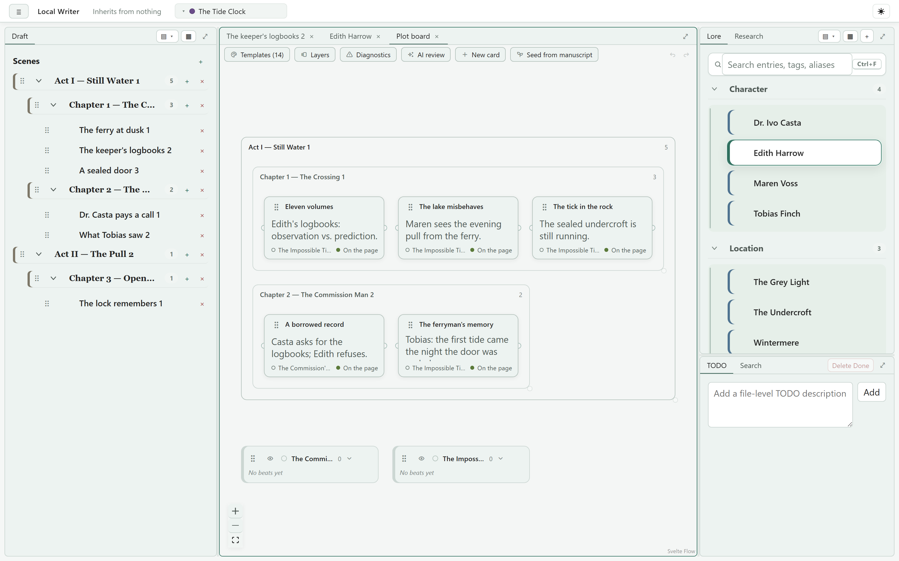

# Local Writing App

A fiction-writing app that runs entirely on your own machine, stores your work as
plain files you can read without it, and treats AI as an optional tool you point
at your prose — not a service you rent. No account, no subscription, no sync —
nothing phones home.



## Getting it

Installers for **Windows, macOS, and Linux** are on the
[latest release](https://github.com/antoncl/local-writing-app/releases/latest) —
download, run, write. Prefer to build it yourself, or curious how it's put
together? → [Running from source](docs/running-from-source.md).

There's also a [website](https://antoncl.github.io/local-writing-app/) — the
same pitch in nicer clothes, fit for sharing.

## Why

**I'm opposed to everything having to be a paid subscription.** Writing software
has drifted into rented access to your own manuscript — stop paying and you're
locked out of work you did. This app is a program you run. If the project is
abandoned tomorrow, the copy on your disk keeps working, and the license lets
anyone pick it up.

**I want the ability to work completely offline.** Files on disk are the source of
truth — Markdown with YAML front matter, plus a handful of YAML files for
structure. Everything else (`.cache/`, indexes) is rebuildable. AI is off by
default and, when you do enable it, [Ollama](https://ollama.com) is a first-class
provider, so the whole app — prose, lore, chat, prompts — can run on a laptop
with the network switched off.

**I think this is the right way to integrate AI into the writing process.** Not a
"write my novel" button. The model gets structured context you authored — the
lore entries, the scenes, the outline — assembled through prompts *you* wrote and
can read. You choose the provider and model per task, you see the token cost of
every call, and the permission model fails closed. It's a research assistant and
a sparring partner sitting next to your manuscript, not a ghostwriter that owns
it.

## What it does

**Manuscript.** A tree of acts, chapters, and scenes — or whatever levels you
name — with drag-reordering. Scenes are Markdown files edited in a WYSIWYG
editor; the front-matter `id` is the canonical identity, so renaming files never
breaks anything. Point of view and tense are set once on the book, an act or a
chapter and inherited by the scenes below.

**Lore.** Entries with types, tags, aliases, references, and Markdown bodies, plus
backlinks. A *mutation set* lets facts change partway through the story — place
it in a scene and from that point on the character is a captain, not a
lieutenant — with a timeline and scrubber showing the effective state at any
point. Tags are entries too: rename, merge and colour them.



**Plot boards.** Plotlines and cards laid out against the manuscript, so
structure is something you can see and rearrange rather than just imagine. Plot
decks and templates give you a starting shape.



**Layered metadata schema.** The app ships a minimal built-in schema, then merges
the `metadata.schema.yaml` of every ancestor project the open project declares it
inherits from — nearer folders override farther ones. You model world / series /
book levels purely by folder depth; the app doesn't hardcode those concepts. Node
types, fields, and their inheritance are authored in-app.

**Views.** Every list in the app is backed by a *view* — a small set-algebra query
(union, intersection, difference, complement, filters, and relational nesting over
lore links) authored in a drag-and-drop node-graph designer. Views are saved as
nodes, can take parameters, and drive grouping and trees.

**AI, when you want it.** Providers: Anthropic, OpenAI, OpenRouter, and Ollama for
local models. Prompts are Jinja2 templates stored as project files — a built-in
library (Draft scene, Continue, line edits, brainstorms, …) you can read and clone,
and your own. A prompt names the lore it needs, or asks the app to add what the
scene mentions, fitted to a budget you set; a context picker constrains what it
may pull in. Chat sessions are nodes like everything else. Per-call token and cost
accounting rolls up to a project total.

**Revising.** A lore check pins notes to the exact words of your prose that
contradict your lore, read as of that point in the story; line edits arrive as
diffs you accept or reject; anything worth keeping becomes a TODO. Change an
entry and *Propagate* finds what depends on it.

**Roleplay.** Characters take turns in a scene, each in their own voice and with
private thoughts, and a finalize pass turns the exchange into prose.

**Also:** research notes with their own tree, project- and scene-anchored TODOs,
snapshots, full-project search and replace, an assistant roster, saveable pane
layouts, and in-app updates on a Stable or Nightly channel.

Deliberately absent: export to Word/PDF/EPUB, collaboration, cloud sync.

## Learning it

The app has a built-in manual: **≡ menu → Help → Guides**. It starts with
*Getting started* and covers lore, custom fields, mutations, views, plotting,
AI setup, writing prompts, and roleplay, plus a full prompt reference. The same
guides are readable here in the repository — start with
[Getting started](docs/getting-started.md).

## Project format

A project is a folder:

```text
project.yaml              # manifest: title, what it inherits, schema version
project.md                # the project node itself
metadata.schema.yaml      # this layer's schema contributions
todo.yaml
ai_invocations.csv        # append-only AI call log and costs
scenes/ lore/ research/   # Markdown + YAML front matter
prompts/ plot/ tags/
chats/ views/ mutation-sets/ snapshots/ overrides/   # appear once used
.cache/                   # disposable, always rebuildable
```

Scenes and lore entries are Markdown with YAML front matter. You can read, grep,
diff, and version-control the whole thing without this app. API credentials are
*not* stored in the project — they live in your system keychain, so a project
folder is safe to commit or share.

## Status

1.0 — the app I write in, stable in the paths I use daily. Since 0.9.5,
storage-format changes migrate your projects forward, and 1.0 makes that a
commitment: your projects survive upgrades. Issues and milestones on GitHub are
the real backlog.

## License

MIT — see [LICENSE](LICENSE). Do what you like with it.
